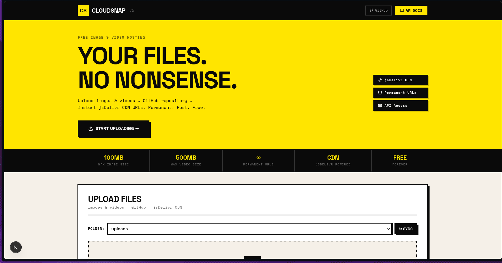
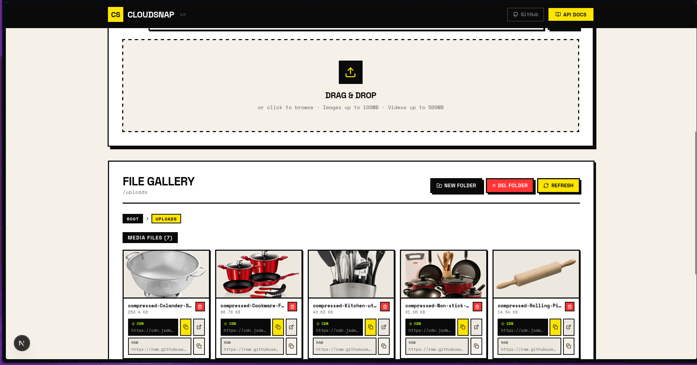

[English](./README.md) · **العربية**

# ⚡ CloudSnap (كلاود سناب)




> **ارفَع أي شيء. احصل على رابط CDN. خلال ثوانٍ.**

أفلت صورة أو فيديو → يُحفظ في مستودع GitHub الخاص بك → يخدمه jsDelivr من أكثر من 100 عقدة طرفية حول العالم. **الرابط يعمل للأبد.** حتى لو حُذف الملف.

**صُنع بواسطة [baraa404](https://github.com/baraa404)** · [github.com/baraa404/Cloud-Snap](https://github.com/baraa404/Cloud-Snap)

---

## ما الذي يفعله خلال 10 ثوانٍ

```bash
curl -X POST \
  -F "file=@screenshot.png" \
  -F "github_token=ghp_xxxx" \
  -F "github_owner=baraa404" \
  -F "github_repo=my-cdn" \
  https://your-cloudsnap.pages.dev/api/public-upload
```

```json
{
  "success": true,
  "urls": {
    "jsdelivr_commit": "https://cdn.jsdelivr.net/gh/baraa404/my-cdn@a3f9c12/uploads/screenshot.png",
    "raw_commit":      "https://raw.githubusercontent.com/baraa404/my-cdn/a3f9c12/uploads/screenshot.png",
    "github_commit":   "https://github.com/baraa404/my-cdn/blob/a3f9c12/uploads/screenshot.png"
  }
}
```

رابط `jsdelivr_commit` هذا؟ إنه **دائم**. مربوط برمز الـ commit. مخزّن عالميًا. يعمل داخل وسوم `` وفي Markdown وفي كل مكان.

---

## لماذا هو ضروري؟

| المشكلة | حل CloudSnap |
|---|---|
| Imgur يحذف الصور القديمة | مستودع GitHub = تخزينك، للأبد |
| شبكات CDN مكلفة | jsDelivr مجاني وفائق السرعة |
| إعداد S3 / Cloudinary متعب | هذا يستغرق 5 دقائق |
| Imgur/Cloudinary يملكون بياناتك | أنت تملك مستودع GitHub |
| لا API للأتمتة | REST API كامل مع أمثلة cURL/JS/Python |

---

## ما الذي تحصل عليه

```
رفعة واحدة → 6 صيغ روابط تلقائيًا:

cdn.jsdelivr.net/gh/...@commit/file  ← ⭐ استخدم هذا (دائم + CDN)
cdn.jsdelivr.net/gh/...@main/file    ← CDN لكن ديناميكي (مبني على الفرع)
raw.githubusercontent.com/.../commit/file  ← خام، دائم
raw.githubusercontent.com/.../main/file    ← خام، ديناميكي
github.com/.../blob/commit/file      ← صفحة GitHub، دائمة
github.com/.../blob/main/file        ← صفحة GitHub، ديناميكية
```

---

## الميزات

- 🖼️ **رفع بالسحب والإفلات** — ملفات متعددة، إعادة تسمية قبل الرفع، منتقي المجلدات
- 📁 **متصفح ملفات** — تنقّل داخل مستودعك كاملًا، معاينة الصور/الفيديوهات داخلًا
- 🕘 **سجلّ الرفع** — كل روابطك التي ولّدتها، نسخ بنقرة واحدة
- 🔒 **دخول برمز PIN** — احمِ مثيلك بكلمة مرور
- 🔑 **مصادقة بمفتاح API** — للوصول البرمجي إلى المسارات الخاصة
- 🌐 **API عام** — لأي أحد الرفع باستخدام توكن GitHub الخاص به، دون مفتاح خادم
- 📹 **دعم الفيديو** — MP4، WebM، MOV حتى 500MB
- 🖼️ **دعم الصور** — JPG، PNG، GIF، WebP حتى 100MB
- ☁️ **سحابة Cloudflare أصلية** — يعمل على الحافة عبر Cloudflare Pages
- 💅 **واجهة Neo-Brutalism** — حدود سميكة، أصفر وأسود، بلا حشو

---

## انشر خلال 5 دقائق (Cloudflare Pages)

1. انسخ (Fork) [هذا المستودع](https://github.com/baraa404/Cloud-Snap)
2. لوحة Cloudflare → Workers & Pages → إنشاء → Pages → اربط بـ Git
3. إعدادات البناء: `npm run build` · الإخراج: `.next` · أضِف `NODE_VERSION=18`
4. اضبط متغيرات البيئة الستة هذه:

| المتغير | ما هو |
|---|---|
| `PIN` | كلمة مرور واجهة الويب |
| `API_KEY` | مفتاح المسارات الخاصة في API |
| `GITHUB_TOKEN` | PAT بصلاحية `repo` (`ghp_xxx`) |
| `GITHUB_OWNER` | اسم مستخدم GitHub الخاص بك |
| `GITHUB_REPO` | المستودع الذي ستُخزَّن فيه الملفات (يجب أن يكون عامًا) |
| `GITHUB_BRANCH` | الفرع المراد الرفع إليه (`main`) |

5. انشر. انتهى. ✓

> المستودع يتضمن `wrangler.toml` — لا حاجة لإعداد إضافي في Cloudflare.

---

## التشغيل محليًا

```bash
git clone https://github.com/baraa404/Cloud-Snap
cd Cloud-Snap
npm install

# أنشئ ملف .env.local بالمتغيرات الستة أعلاه
npm run dev
# → http://localhost:3000
```

---

## نظرة على API

| الدالة | المسار | المصادقة | ما الذي يفعله |
|---|---|---|---|
| `POST` | `/api/public-upload` | بدون (أحضر توكن GitHub الخاص بك) | رفع ملف |
| `POST` | `/api/upload` | مفتاح API | رفع باستخدام بيانات الخادم |
| `GET` | `/api/list-files?path=` | مفتاح API | سرد الملفات/المجلدات |
| `DELETE` | `/api/delete-file` | مفتاح API | حذف ملف |
| `POST` | `/api/create-folder` | مفتاح API | إنشاء مجلد |

التوثيق الكامل ← `/api-docs` على مثيلك المنشور.

---

## التقنيات

Next.js 15 · Tailwind CSS v4 · Lucide Icons · Cloudflare Pages · GitHub API · jsDelivr CDN

---

**CloudSnap © 2026 · صُنع بواسطة [baraa404](https://github.com/baraa404)**