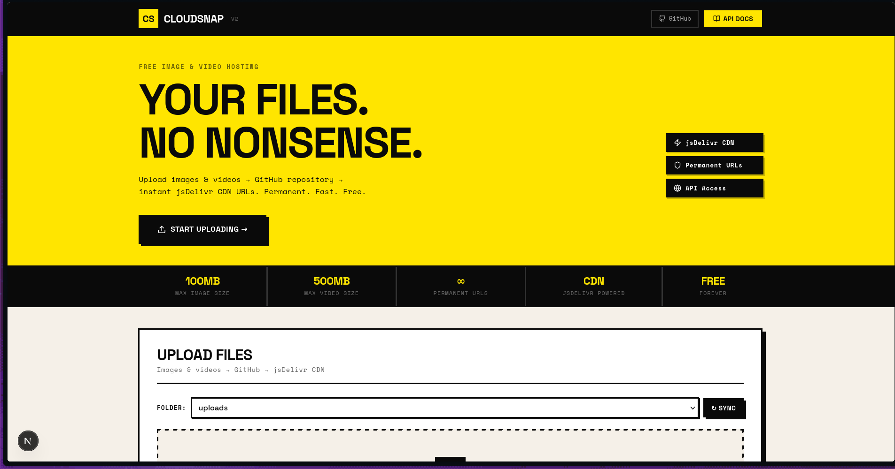
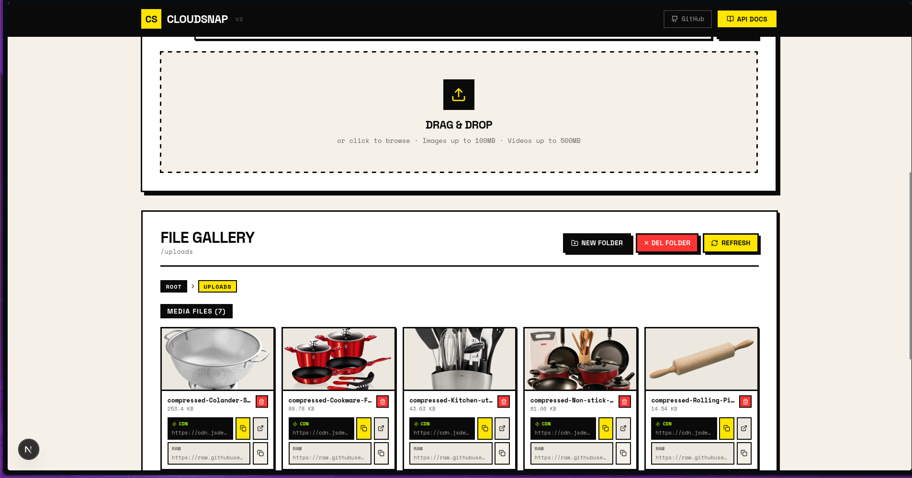

# ⚡ CloudSnap

<div align="center">
  **English** · **[العربية](README.ar.md)**
</div>




> **Upload anything. Get a CDN URL. In seconds.**

Drop an image or video → it hits your GitHub repo → jsDelivr serves it from 100+ edge nodes worldwide. **The URL works forever.** Even if the file gets deleted.

**Made by [baraa404](https://github.com/baraa404)** · [github.com/baraa404/Cloud-Snap](https://github.com/baraa404/Cloud-Snap)

---

## What it does in 10 seconds

```bash
curl -X POST \
  -F "file=@screenshot.png" \
  -F "github_token=ghp_xxxx" \
  -F "github_owner=baraa404" \
  -F "github_repo=my-cdn" \
  https://your-cloudsnap.pages.dev/api/public-upload
```

```json
{
  "success": true,
  "urls": {
    "jsdelivr_commit": "https://cdn.jsdelivr.net/gh/baraa404/my-cdn@a3f9c12/uploads/screenshot.png",
    "raw_commit":      "https://raw.githubusercontent.com/baraa404/my-cdn/a3f9c12/uploads/screenshot.png",
    "github_commit":   "https://github.com/baraa404/my-cdn/blob/a3f9c12/uploads/screenshot.png"
  }
}
```

That `jsdelivr_commit` URL? It's **permanent**. Commit-pinned. Globally cached. Works in `` tags, markdown, anywhere.

---

## Why bother?

| Problem | CloudSnap's answer |
|---|---|
| Imgur deletes old images | GitHub repo = your storage, forever |
| CDNs cost money | jsDelivr is free and blazing fast |
| S3 / Cloudinary setup is painful | This takes 5 minutes |
| Imgur/Cloudinary own your data | You own the GitHub repo |
| No API for automation | Full REST API with cURL/JS/Python examples |

---

## What you get

```
One upload → 6 URL formats automatically:

cdn.jsdelivr.net/gh/...@commit/file  ← ⭐ use this (permanent + CDN)
cdn.jsdelivr.net/gh/...@main/file    ← CDN but dynamic (branch-based)
raw.githubusercontent.com/.../commit/file  ← raw, permanent
raw.githubusercontent.com/.../main/file    ← raw, dynamic
github.com/.../blob/commit/file      ← GitHub page, permanent
github.com/.../blob/main/file        ← GitHub page, dynamic
```

---

## Features

- 🖼️ **Drag & drop uploader** — multi-file, rename before upload, folder picker
- 📁 **File browser** — navigate your whole repo, preview images/videos inline
- 🕘 **Upload history** — every URL you've ever generated, one click to copy
- 🔒 **PIN login** — protect your instance with a password
- 🔑 **API key auth** — for programmatic access to private routes
- 🌐 **Public API** — anyone can upload using their own GitHub token, no server key needed
- 📹 **Video support** — MP4, WebM, MOV up to 500MB
- 🖼️ **Image support** — JPG, PNG, GIF, WebP up to 100MB
- ☁️ **Cloudflare-native** — runs on the edge via Cloudflare Pages
- 💅 **Neo-Brutalism UI** — thick borders, yellow & black, no fluff

---

## Deploy in 5 minutes (Cloudflare Pages)

1. Fork [this repo](https://github.com/baraa404/Cloud-Snap)
2. Cloudflare Dashboard → Workers & Pages → Create → Pages → Connect to Git
3. Build settings: `npm run build` · output: `.next` · add `NODE_VERSION=18`
4. Set these 6 env vars:

| Variable | What it is |
|---|---|
| `PIN` | Password for the web UI |
| `API_KEY` | Key for private API routes |
| `GITHUB_TOKEN` | PAT with `repo` scope (`ghp_xxx`) |
| `GITHUB_OWNER` | Your GitHub username |
| `GITHUB_REPO` | Repo to store files in (must be public) |
| `GITHUB_BRANCH` | Branch to upload to (`main`) |

5. Deploy. Done. ✓

> The repo includes `wrangler.toml` — no extra Cloudflare config needed.

---

## Run locally

```bash
git clone https://github.com/baraa404/Cloud-Snap
cd Cloud-Snap
npm install

# Create .env.local with the 6 vars above
npm run dev
# → http://localhost:3000
```

---

## API overview

| Method | Endpoint | Auth | What it does |
|---|---|---|---|
| `POST` | `/api/public-upload` | None (bring your own GitHub token) | Upload a file |
| `POST` | `/api/upload` | API key | Upload using server credentials |
| `GET` | `/api/list-files?path=` | API key | List files/folders |
| `DELETE` | `/api/delete-file` | API key | Delete a file |
| `POST` | `/api/create-folder` | API key | Create a folder |

Full docs → `/api-docs` on your deployed instance.

---

## Stack

Next.js 15 · Tailwind CSS v4 · Lucide Icons · Cloudflare Pages · GitHub API · jsDelivr CDN

---

**CloudSnap © 2026 · Made by [baraa404](https://github.com/baraa404)**
